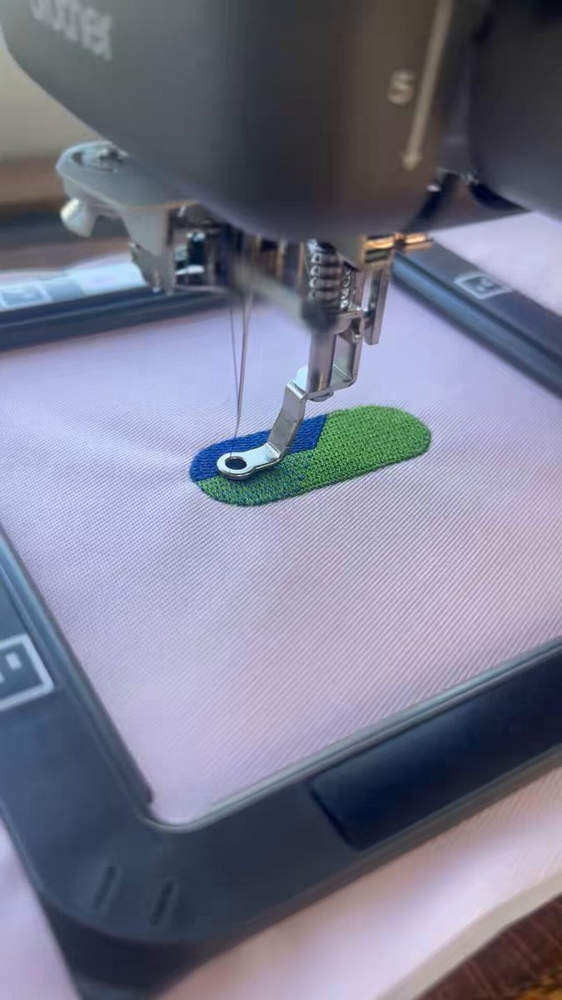

# ZigZag

**[Visit zigzag.diy](https://zigzag.diy/)**

ZigZag is a visual embroidery editor built in Rust for performance, with
built-in **MCP (Model Context Protocol)** support so AI agents can create and
edit designs alongside you. Turn SVG artwork into stitches, fine-tune it in
the editor, and export **PES, DST, EXP, JEF, or VP3** for broad compatibility
with embroidery machines—or send designs directly to a **Brother Skitch
(PP1) over Bluetooth**.

Draw in Illustrator, draw in ZigZag, or let an agent draw. The Rust engine
and `zigzag` command-line tool power the same workflow outside the editor.

## See ZigZag in action

https://github.com/user-attachments/assets/94812f25-82f4-429f-85db-5e20c1d5e723

**Stitching on a Brother Skitch (PP1)**

<a href="https://github.com/simpsoka/zigzag/raw/refs/heads/main/packaging/media/skitch-pp1-demo.mp4">
  
</a>

[Download the video (MP4, 1080p)](https://github.com/simpsoka/zigzag/raw/refs/heads/main/packaging/media/skitch-pp1-demo.mp4)
· [Original post on X](https://x.com/simpsoka/status/2115254318161182876).

## Download for Mac

**[Download ZigZag.dmg](https://github.com/simpsoka/zigzag/releases/latest/download/ZigZag.dmg)**

For Apple Silicon and Intel Macs, macOS 11 or later. Open the DMG, then drag
ZigZag into Applications. The release is signed and notarized by Apple.
No Rust installation is needed.

Or with [Homebrew](https://brew.sh):

```sh
brew install --cask simpsoka/zigzag/zigzag
```

To update a Homebrew installation:

```sh
brew upgrade --cask --greedy simpsoka/zigzag/zigzag
```

Starting with version 0.1.3, ZigZag also offers an in-app updater: it tells
you when there's a newer release and installs it when you say (ZigZag ›
Check for Updates…).

## Download for Windows

**[Download ZigZag for Windows](https://github.com/simpsoka/zigzag/releases/latest)**
— the `ZigZag-<version>-x86_64-windows.zip` asset on the latest release.

For 64-bit Windows 10 (version 1709 or later) and Windows 11. Unzip it and
double-click **ZigZag.exe**. Windows SmartScreen warns on apps without a
Microsoft-trusted signature the first time they run; click *More info* →
*Run anyway*. No Rust installation is needed.

## Download for Linux

**[Download ZigZag for Linux](https://github.com/simpsoka/zigzag/releases/latest)**
— the `ZigZag-<version>-x86_64-linux.tar.gz` asset on the latest release.

For x86-64 Linux desktops with glibc 2.35 or newer (Ubuntu 22.04+, Debian 12+),
X11 or Wayland, and OpenGL. Extract the archive and run `./zigzag-studio`
inside the extracted folder. It also includes the `zigzag` CLI and
`zigzag-mcp` bridge; no Rust installation is needed. See the included
`README.txt` for runtime dependencies and Bluetooth setup.

[Release notes and checksums](https://github.com/simpsoka/zigzag/releases/latest)
· [Changelog](CHANGELOG.md)
· [Publishing a release](RELEASE.md)

```
zigzag/
  src/svg.rs              SVG import (usvg): fill and stroke parts, transforms, text
  src/document/           editable document; settings saved back into SVG ids,
                          layout edits as SVG transforms, lettering
  src/params.rs           stitch settings tokens + fabric presets
  src/stitch/fill.rs      tatami fill (scanline sections, staggered rows)
  src/stitch/satin.rs     satin columns: two rails, auto-satin, underlays, short stitches, lean
  src/stitch/columns.rs   shapes that branch or have holes, cut into satin columns
  src/stitch/stroke.rs    running / triple-run stitch
  src/boolean.rs          polygon booleans and offsets (i_overlay)
  src/design.rs           planner: overlap removal, cap order, routing, trims
  src/route.rs            travel out of sight: a way through fills and under what covers
  src/checks.rs           digitizing checks (sizes, widths, lettering, hoop)
  src/machine/profile.rs  machine profiles: hoops and file format, built in (profiles.json) or your own
  src/formats/            PES (+PEC), DST, EXP, JEF, VP3, Skitch PEN writers;
                          PES/PEC/DST/EXP/JEF readers; preview; worksheet
  src/machine/            Skitch Bluetooth protocol (+ btleplug client, `ble` feature)
  src/studio/             editor (egui on OpenGL via glow) + MCP server (`gui` feature)
  src/mcp_bridge.rs       stdio ↔ HTTP bridge for MCP clients that launch a command
```

## Build

```sh
cargo build --release                        # CLI + MCP bridge, no system deps
cargo build --release --features gui,ble     # + the studio editor and Skitch upload
```

Linux needs the usual X11/Wayland and OpenGL dev libraries for `gui`. libdbus
is vendored for `ble`.

## Stitch types

| Type | What it does | Works on |
|---|---|---|
| **Fill** (tatami) | Staggered rows, any angle, with underlay (edge walk + rows) and pull compensation | Filled shapes |
| **Satin** | Zigzag column between two rails, with center/contour/zigzag underlay, pull compensation and short stitches on tight curves; plain, S-stitch or zig-zag top stitching; stitches square across or leaning (`lean=8`); several threads across the column (multicolor satin) | Strokes (any width); Ink/Stitch-style two-rail paths with rungs; **filled shapes**: rings use inner/outer outline, bars and crescents split at their tips, letters and other shapes that branch or have a counter are cut into columns where the branches part (a P into its stem and bowl, a T into bar and stem), or `border` follows the outline |
| **Run** | Running stitch, single or triple (bean) | Strokes and outlines |
| **Contour** | Rows that follow the outline inward, or one spiral out from the center (Ink/Stitch's circular fill) | Filled shapes |
| **Blanket** | E-stitch: a line with prongs into the shape | Edges, appliqué |
| **Appliqué** | Placement line → stop → tack-down → stop → satin cover | Filled shapes |
| **Manual** | Every path point is a needle point | Imported machine files, pen tool |
| **Meander** | One wandering line through the shape, quilting style: light and soft | Filled shapes |
| **Ripple** | Open running-stitch rows following the outline, or one spiral | Filled shapes |
| **Cross-stitch** | A grid of X's, sewn as rows of half-crosses out and back | Filled shapes |
| **Tartan** | Woven stripes in several threads (a mirrored sett you edit in the panel), each thread its own color block | Filled shapes |

Satins wider than 7 mm are **auto-split** (shorter, staggered stitches) and
use **auto spacing** (narrow columns more open, wide ones denser).

Planner features:
- **Remove overlaps:** fill hidden under later objects isn't sewn (keeps 0.5 mm of overlap).
- **Cap order:** center-out, bottom-up, grouped by color, still respecting layering.
- **Routing:** travel stitches stay out of sight: straight across where a straight line stays inside the fill, otherwise round the inside of its outline (Ink/Stitch's underpath), otherwise any way through the fill (round its holes, through its necks), under a satin that's about to be sewn, or under whatever is sewn later on top. An object's last piece is sewn toward the end the next object can be reached from. So satin lettering sewn stroke by stroke needs cuts only between letters when each stroke is followed by one that covers the way to it (a T's stem before its bar; an E's bars before its stem). A fill in separate parts is sewn part by part, each part's underlay and top together. So a fill with cut-outs, or a dither in scattered blocks under another color, is sewn with few or no cuts. Trims only where none of that works (up to 50 mm of travel).
- **Sewing control per object:** a start and an end point (where the thread comes in and leaves, so the next object is close), trim after, stop after (to lay foam or trim appliqué). What's left to cut is the document's Connect bar: drag it to sew across gaps up to N mm (between objects, or the parts of one) with running stitches instead of cuts. Those stitches show, so the panel counts the cuts saved as you drag and the canvas lights up what would be sewn.
- **Fabric presets:** standard, thin cotton cap, structured cap, knit.
- **Checks:** narrow fills, wide/narrow satins, small lettering, tiny gaps, fully covered objects, hoop fit.
- **Group colors:** reorder to cut thread changes without breaking layering.

## Mac app

On a Mac with [Rust](https://rustup.rs) and the Xcode command line tools
(`xcode-select --install`):

```sh
packaging/macos/make-app.sh --install    # builds ZigZag.app and copies it to /Applications
packaging/macos/make-app.sh --dmg        # also makes dist/ZigZag-<version>.dmg to share
packaging/macos/make-app.sh --universal  # one app for Apple Silicon and Intel Macs
packaging/macos/make-app.sh --release    # the DMG to publish: universal, signed, notarized
```

`--release` signs with your Developer ID and has Apple notarize the app and
the DMG, so it opens on any Mac without warnings. Once, beforehand: add a
*Developer ID Application* certificate (Xcode › Settings › Accounts › Manage
Certificates › +), make an app-specific password at account.apple.com, and
save the notarization credentials in your keychain:

```sh
xcrun notarytool store-credentials zigzag-notary --apple-id YOUR_APPLE_ID --team-id YOUR_TEAM_ID
```

The app bundles the studio, the `zigzag` command-line tool and the MCP
bridge. To use the command line from anywhere:
`ln -s /Applications/ZigZag.app/Contents/MacOS/zigzag /usr/local/bin/zigzag`.
For Claude Desktop, point the MCP config at
`/Applications/ZigZag.app/Contents/MacOS/zigzag-mcp`.

Without `--release` the app is signed ad hoc, not notarized. It opens normally on the Mac that
built it. On another Mac, macOS blocks it the first time: open System
Settings › Privacy & Security and click Open Anyway (on macOS 14 and earlier,
right-click the app and choose Open instead). macOS asks for Bluetooth
permission the first time you send to the Skitch.

## Studio

The approved embroidered icons live in `packaging/macos/AppIcon.png` (light)
and `packaging/macos/AppIcon-dark.png` (dark). The Mac build regenerates both
multi-resolution `.icns` files; run `bash packaging/macos/make-icons.sh` to
regenerate them separately. Finder and the unopened app use the light icon.
While the studio is running, its Dock icon follows the app's light/dark theme,
including the `ZIGZAG_THEME=light|dark` override.


```sh
zigzag-studio [design.svg|logo.png] [--mcp-port 7878 | --no-mcp | --mcp-stdio]
```

Laid out like Illustrator, styled like a Mac app:
- **Tools** down the left edge: Select (V), Direct Selection (A), Hand (H), Pen (P): click for corners, drag for curves (Option breaks the handles, Shift keeps 45°, Space moves the point being placed); while drawing, Option lends it the Anchor Point tool (drag a segment to bend it, a handle to move it alone, click a smooth point for a corner) and ⌘ lends Direct Selection (drag a point or handle, then keep drawing), and on a selected path Option-drag bends a segment too. Illustrator's Pen group is behind it: Add Anchor Point (+) clicks a point onto an outline without changing its shape, Delete Anchor Point (-) clicks one out (Option swaps the two while held), and Anchor Point (Shift+C) converts points between smooth and corner and drags one handle alone. Press and hold the Pen (or right-click it) for the group's flyout, Option-click it to step through the group, or tear the group off into a toolbar of its own with the strip at the flyout's edge; the Shape tools work the same way. Brush (B), with VectorCraft's path clean-up tools in its group: Smooth (drag along a path to take the wobble out: fewer points, smoother curves; Smoothness in the bar above), Path Eraser (drag across a path to cut that part away) and Join (scrub between two open ends to join them, or an open path's two ends to close it). Shapes (M rectangle, L ellipse, \\ line; hold or right-click for polygon and star), Rotate (Shift+R; R alone is the Run stitch), Fill Angle (G), Measure (I), Text (T). Below them, the selection's thread swatch: click it for the thread color picker.
- **Curves, the Illustrator way:** the Pen clicks corners and click-drags curves (Option while dragging breaks the handle for a sharp turn; Shift keeps points and handles at 45°; hold Space to move the point you're placing). Click the last point to make it a corner, or drag from it to start the next curve in a new direction. Click the first point to close a shape; Enter, Esc, ⌘-click or another tool ends a line and keeps it. With a path selected, the Pen continues it from an open end, adds a point on its outline, deletes a point you click, and Option-click turns a point corner ↔ smooth (Option-drag pulls out new handles). While drawing, click another open path's end to join the two into one. The cursor shows what a click will do. Direct Selection drags points and handles of any shape from your SVG (circles and rects become paths); dragging a curve bends it under the pointer (Option-drag bends a straight one; a plain drag moves it); Delete removes points, arrows nudge them.
- **Smart guides while drawing** (View › Smart Guides, ⌘U): Pen points, shape corners and dragged points land on other objects' anchors and centers, where two outlines cross, on an outline, on 45° rays from the last point (level and upright handles too), or in line with any of those, with a magenta label saying which ("anchor", "intersect", "path", "align"…). With Shift, a point keeps its 45° angle and slides into line with the nearest target.
- **Round corners:** in Direct Selection a small circle sits inside each sharp corner; drag it in to round the corners (the selected points', or all of them), each only as far as its sides allow. Object › Path › Round Corners… does the same with a radius and Round, Inverted or Chamfer, previewed live.
- **Brush** (B), after Illustrator's Paintbrush: paint a line freehand and it comes out smooth, sewn as a satin column at the width you set (or as a running stitch). Smoothness takes out the hand's wobble; sharp turns stay sharp; end where you began to close the line. The cursor is a circle as wide as the satin.
- **Curvature** (Shift+`, in the Pen's group), after VectorCraft's and Illustrator's: click points and the curve runs smoothly through them, with no handles to pull. Option-click (or double-click a point) for a corner; drag a point and the whole curve follows; click the first point to close a shape, or Enter to end a line.
- **Blob Brush** (Shift+B, in the Brush's group): paint a filled shape in the selection's thread. Where the paint overlaps fills in that thread it joins them into one shape. `[` and `]` size the brush.
- **Lasso** (Q, with Direct Selection): draw a loop round points or objects to select them; Shift adds, Option takes away. Part of one object is its points, which Direct Selection then moves.
- **Shape Builder** (Shift+M) and **Knife** (K), in one group: with overlapping shapes selected, drag across their parts to make one shape of them (Option takes parts away; a click makes a part a shape of its own), each shape keeping what's left of itself. The Knife cuts filled shapes along a line drawn right across them (Option: a straight cut), so that each piece can have its own stitch angle.
- **Eyedropper** (E, with Measure): click an object to give the selection its thread and stitch settings; Option-click gives the clicked object the selection's; Shift-click takes the thread alone.
- **Shapes, the Illustrator way:** Rectangle (M), Ellipse (L), Polygon, Star and Line (\\). Drag from a corner; Option draws from the center, Shift makes a square or circle, keeps a polygon or star upright and a line at 45°. While dragging a polygon or star, ↑/↓ add or remove sides or points. Click without dragging to type an exact size. The bar at the top of the canvas switches shapes and sets corner radius, sides, points and the star's inner radius. Closed shapes come in as fills, lines as runs, in the current thread.
- **Path tools:** Object › Pathfinder (Unite, Minus Front, Intersect, Exclude; also buttons in the Transform panel when two or more objects are selected) and Object › Path (Offset Path…, Add Outline, Outline Stroke, Simplify…, Round Corners…, Clean Up…). Simplify… is VectorCraft's slider, from fewest points to closest to the original, previewed live, with Auto-Simplify picking the level for the selection's size. Clean Up… removes stray points, objects too small to sew (under 1 mm by default) and extra points (points on top of each other, points in the middle of straight lines), showing how many of each it found first. Results come back as smooth curves with their real corners (least-squares curve fitting), not as many-sided polygons.
- **Logos from images (Image Trace):** open, drop or place a PNG, JPEG, WebP, GIF, BMP or TIFF and the Trace Image window traces it into flat-color shapes, previewed on your hat's color. Choose how many colors (or Auto), the width, detail and the smallest speck to keep; remove the white background; snap every color to your Brother, Janome or own palette's threads; and sew thin lines as single lines. Flat logos trace exactly (edges placed to a fraction of a pixel, corners restored, circles and straight lines exact); photos are posterized. The command line traces too: `zigzag convert logo.png -o logo.pes`.
- **Contextual task bar:** under the selection, the next things you'd do: its stitch type, its thread, Edit Points, Round Corners, Simplify, Unite (two or more), Duplicate. Drag the grip at its left end to move it off the art: it keeps that distance as it follows the selection, or stays put with Pin Bar Position in its ••• menu (Reset Bar Position puts it back). View › Contextual Task Bar (or its ••• menu) hides it.
- **Ask an agent:** the Agent panel (full height in the left dock; the sparkle at the bottom of the tool strip opens and closes it, and ⌘K or Window › Ask Agent… opens it with the prompt ready) runs Claude Code or Codex in the background, connected to this studio's MCP server, so you watch it build the design. It can only use the design tools (no shell, no file edits). The transcript shows what it said and each step, with a spinner on the one running (the one place it's shown; collapse the panel and its header shows the step and the time instead). On the canvas, the objects it's working on get a moving outline, a shimmer and a label saying what it's doing (Drawing, Placing, Restyling…), for any agent connected over MCP, not just the panel's. The panel is named for the agent (Claude Code or Codex; switch in its ≡ menu); + in its header starts a new chat, Stop ends a run. Uses the `claude` or `codex` command you've already signed in to. Like any panel it can float, join another as a tab or dock right; sharing a dock it sits at the bottom, under a divider you drag to give it more room.
- **Thread colors and palettes:** the picker shows the nearest Brother/Janome thread, a palette to click (Brother, Janome or your own), and a small custom color field. Make palettes from scratch, from the design, or from a thread kit you own (the palette's ≡ menu › New Palette from Thread Kit: Brother's 12, 40 and 22 color sets, or 40 + 22 for all 61; then Match All keeps a design to the threads in your box), add the selection's thread with +, right-click to remove; they're remembered between launches.
- **Threads panel:** the design's threads in sewing order (each color block numbered, with its stitches, and "stop" where the same thread comes twice running) or By Color (each thread once, with how many objects use it). Click a row to select what it sews; click a swatch to change that block's thread, or in By Color that thread everywhere. Group Colors and the count of color changes and trims are under the list. The panel's ≡ menu has Match All to the chosen palette, and Show Palette puts a palette to click under the list (off by default, since the thread picker has the same palettes).
- **Simplify Design** (Object › Simplify Design…, or Simplify… in the Threads panel): make a design quicker to sew. Merge the threads most alike down to a number (each pair becomes the one that sews more, so they stay real threads), take out details too small to sew well, sew across short gaps instead of trimming, sew each thread together, and (if you choose) unite layers that touch in one thread into one shape, so nothing is sewn under or between them: only the ones sewn the same way (a satin on a fill stays), or all of them. It previews on the canvas as you drag, with threads, thread changes, trims, stitches and sewing time before and after beside the controls; OK is one undo step.
- **Panels, the Illustrator way:** the Agent has the left dock to itself; Layers, Stitch, Transform, Lettering, Threads and Document are on the right. The design's issues are in the status bar (bottom right): a warning sign with a count, or a check when all's well; click it (or Window › Issues) for the list, each linked to its object. Drag a panel by its header to reorder it, move it to the other dock, or drop it on the canvas to float it (each panel's ≡ menu also has Dock Left / Dock Right / Float). Drop a panel on another panel's header and they share it as tabs; drag a tab out (or use Separate in the ≡ menu) to part them, drag the header to move the group. » at the top of a dock collapses it to a strip of icons for a bigger canvas: click an icon and the panel flies out beside the strip (drag an icon to move that panel). Click a header to collapse a panel; Window › Reset Panels puts everything back. The layout is remembered.
- **Layers list:** what's on top is at the top, as in Illustrator: the last layer sewn is the first row and the background is the last. Drag a row to another place in the stack (a line shows where it will go; the rows selected with it go too, and a group's row takes all its layers), or use the arrows under the list: up is sewn later, down is sewn earlier. The panel's ≡ menu has List in Sewing Order, for the list the other way up (what's sewn first at the top, as the Threads panel and embroidery software list it; dragging and the arrows follow). A document's only group starts open.
- **Rename an object:** double-click its name in the Layers list, as in Illustrator; Enter keeps the name, Escape doesn't. A single click only selects.
- **Tabs, one per document** (as in VectorCraft and Illustrator): Open, drop or New opens a file in a tab of its own over the canvas (the empty document you start with makes way for the first one); a file that's already open just comes forward. Each tab keeps its own undo history, selection, zoom and stitches. Click a tab to switch, ⌃Tab / ⌃⇧Tab (or Window › Next / Previous Document) to step through them, drag one to reorder, middle-click or its × (or File › Close, ⌘W) to close it; + opens a new document and » lists every tab when they don't all fit. A dot in place of the × marks unsaved changes, and closing such a tab asks whether to save it first. Right-click a tab for Close Other Tabs and Copy Path. Quitting with unsaved changes asks too (Save, or Save All for several; Don't Save; Cancel), as VectorCraft does, though not saving loses nothing: every tab comes back next time, each with its unsaved changes, and the files stay as they were until you save.
- **Lock and hide:** every row of the Layers list has an eye and a lock (Illustrator's Layers columns; Option-click for every other object, and Object › Lock ⌘2, Unlock All, Hide ⌘3, Show All). A hidden object isn't shown or sewn; a locked one can't be selected or moved, so a background stays put while you work on what's over it. Drag the Selection tool over empty canvas for a selection box; two-finger scroll, Space-drag or the Hand tool moves the canvas.
- **Updates itself:** ZigZag looks at its latest release on GitHub when it opens, and the toolbar shows an Update button when there's a newer one. On a Mac, Install and Relaunch downloads it, checks it against the release's checksum and Apple's code signature (it has to be signed by the same developer as the copy that's running), swaps it in and reopens with your documents as they were. ZigZag › Check for Updates… looks on demand; Settings › General turns the automatic look off. Windows and Linux are told and taken to the download.
- **Travel stays out of sight:** the thread gets from one part of an object to the next under stitches still to come or under what's sewn on top; a fill's sections are sewn in the order that allows it. Where there's no such way the thread is cut, or (Document panel › Travel › Sew over fill) sewn over the fill already there, which saves cuts and shows. The checks say when travel crosses stitches already sewn.
- **Menu bar** (File, Edit, Object, Type, View, Window, Help) with the usual ⌘ shortcuts. Help › Report an Issue… opens a new issue on GitHub in your browser, started with which ZigZag you have and what it's running on. It's the real macOS menu bar on a Mac, drawn in the window elsewhere.
- **Crash logs:** if something inside ZigZag fails badly enough to stop it, a short log of what failed and where is kept in the settings folder (`crashes/`, the newest ten; Help › Show Crash Logs opens it). The next time ZigZag opens it offers to report it: a GitHub issue started with the gist of the log, and the file shown so it can be attached. Nothing is sent unless you post it, and people's names are taken out of the paths in it. Help also has ZigZag on GitHub, and About ZigZag links there too.
- **Cursors drawn for each tool:** the Pen's nib (with what a click will do), crosshairs for the Shape, Rotate, Measure and Fill Angle tools, Direct Selection's hollow arrow, and a curved arrow at rotate corners and while the Rotate tool turns.
- **Right-click menus** on the canvas and the Layers list, styled like the tool flyouts: the stitch types with their icons, then the usual commands with their shortcuts.
- **Stays quick on big designs:** stitches are planned once per change, reusing every object that didn't change (overlap removal too: moving one object redoes only the objects it overlaps); a design that takes more than 12 ms to plan plans in the background (the status bar says "Updating stitches…" and the last plan stays on screen meanwhile; when you drop a moved object its stitches move with it until the new plan lands). Dragging points or objects, and typing, preview without re-planning until you let go. The stitches live on the GPU: each color block's segments are uploaded once and drawn by a shader (thread shading and needle points included), so panning, zooming, dragging and the stitch player cost nothing per stitch on the CPU, whether the design has a thousand stitches or half a million. The Layers list lays out only the rows in view. An object whose stitches hit an internal error is left out with a warning in Issues rather than taking the plan down. For development: `TL_PROFILE=1` prints each frame's sections to stderr, `TL_NO_GPU=1` draws the stitches with the painter instead, and `cargo test --release --features gui --bin zigzag-studio perf_bench -- --ignored --nocapture --test-threads=1` times typing and dragging on a traced logo (`examples/bench-grid.svg` is a 213,000-stitch design for the studio itself).
- Follows the system's **light or dark** appearance (`ZIGZAG_THEME=light|dark` overrides) and uses the San Francisco system font on a Mac.
- **Interface size:** Settings › General draws everything in the window larger or smaller (90% to 150%): panels, text, buttons and the handles on the canvas. Your design keeps the size it has on screen, the window never gets smaller than the layout needs, and a size the display has no room for steps down to the largest that fits.

- **Pick a stitch type per object:** big buttons, the task bar, right-click, or F/S/R/C/X (Blanket and Manual from the Stitch panel). The preview re-plans live.
- **Layout, the Illustrator way:** drag to move (Shift: 45° steps; Option: drag a copy). Handles resize freely (Shift keeps proportions, Option resizes from the center, drag past the far side to flip); just outside a corner rotates (Shift: 45°). Smart guides snap edges and centers to other objects and the hoop (View › Smart Guides, ⌘U). ⌘D is Transform Again: Option-drag a copy, then ⌘D for more at the same spacing. Hold Space to pan with any tool (a tap plays the stitch-out). The Transform panel has Illustrator's reference point: X/Y show the chosen point and W/H resize around it. Also rotate, flip, center in hoop, fit to hoop (artwork bigger than the hoop is scaled down to fit when you open or place it; Undo restores full size), ⌘C/⌘V, arrows nudge 0.5 mm (Shift 5 mm). Edits are saved as SVG transforms.
- **Groups work like Illustrator:** a click or drag takes the whole group; double-click goes into it (the rest dims and a breadcrumb shows where you are), double-click again to go deeper; Esc or double-click on empty canvas comes back out. ⌘-click picks one object without going in. Layers (Illustrator's "Layer 1", Inkscape layers, Figma frames) aren't groups. Copy, paste and duplicate keep groups.
- **Rotate** (Shift+R, or Object › Rotate Tool), as in VectorCraft and Illustrator: the selection turns about a reference point, drawn as a small target. It starts at the selection's center; click to put it anywhere (it snaps to the nearest anchor or center, labelled as you hover), then drag from anywhere to turn the selection about it, the stitches following and the angle beside the pointer. Shift turns in 45° steps; hold Option as you let go to leave the original and drop a turned copy. Option-click sets the point and opens the Rotate dialog for an exact angle, laid out as VectorCraft's: the angle, Copy (leave the original and turn a copy), Preview (see the turn on the canvas before OK), then Cancel and OK. A double-click on the canvas opens it too, and so do Return, a double-click on the tool's button and Object › Rotate…, about the point as it is. ⌘D repeats the turn about the same point, copy and all: set the point, Option-drag one copy, then ⌘D round the ring. The point belongs to the selection it was set for and goes back to the center when the selection changes. Text and shapes with live corners stay text and stay live.
- **Type** (T), as in VectorCraft and Illustrator: click where the text should go and type straight onto the canvas (Enter for a new line, Esc or a click elsewhere when done); click text, or between its letters, to edit it with the caret where you clicked (or double-click it with the Selection tool, which picks text anywhere in its box and shows it as a box, not its letters' points; delete every letter and finish, and the text is removed) (←/→, ↑/↓, Home/End and ⌘←/→ move it; Backspace and Delete remove either side; Shift with any of those, a drag, a double-click for a word, a triple-click or ⌘A for the lot selects text, which typing replaces and ⌘C/⌘X/⌘V copy, cut and paste); click a selected path to put text on it. The Lettering panel is a compact Character panel (hat text isn't long copy): font (with search), bold/italic, letter height, tracking, pair kerning (pick the pair, or Option+←/→ while typing kerns the pair at the caret), horizontal and vertical scale, case (as typed, UPPER, lower, Title), alignment and leading for two-line text, baseline (straight, arc over, arc under, or on a path with offset and flip), and the stitch type. The Type menu has Type on a Path, Change Case, Align and Create Outlines (⇧⌘O). Text is a shape like any other: Direct Selection, Round Corners, Simplify, Pathfinder and Clean Up all work on it (it quietly becomes plain paths at the first point-level edit, one undo step), and it saves as real SVG text until then.
- **Pen** (P): draw filled shapes or lines with corners and curves, or place manual stitches one by one. Snaps to the grid when it's showing, else to smart guides.
- **Shapes** (M, L, \\): rectangles (with rounded corners), ellipses, polygons, stars and lines.
- **Measure**, **mm grid**, **needle points**, **First/Last**, **Group colors**.
- **Open machine files** (PES, PEC, DST, EXP, JEF) to view, resize and re-export them, and **images** to trace.
- **Keep stitch density (experimental):** select imported stitches, enable **Keep stitch density** in the Transform panel, then change W/H or drag a resize handle. Regular tatami fills and satin columns are rebuilt with their original row/peak spacing in millimeters. Curved satin lettering can contain several sections in one run: nearby edge stitches are grouped into needle visits, paired rails are reconstructed, and short connecting paths are kept in sewing order. Editing individual points invalidates the saved source so subsequent resizing respects your edits. **Uncertain spans still resize normally, without preserving density.**
- **Settings per type:** fill angle (with a drag-to-set **angle tool**, `A`), spacing, length, pull, underlay. Satin options: column vs border, stitch (satin, S-stitch, zig-zag), threads across the column, width, underlay passes, short stitches. Contour and ripple: rings or spiral. Cross-stitch: cell size. Tartan: the stripes (color and width each, mirrored), angle, row spacing. Run options: single or triple.
- **Lean** in the Stitch panel, for satins: how far the stitches lean from square across the column (a few degrees keeps them from sinking between a knit's rows; more shows a slant, like a leaf's veins).
- **Sewing row** in the Stitch panel: Start and End (click the outline; green and red markers you can drag), Trim and Stop after the object. Edit › Copy / Paste Stitch Settings carries one object's type and settings to others (each keeps its thread and start/end); Edit › Select Same Stitch Type; Object › Path › Reverse Direction sews a path from its other end.
- **Test swatches** (Object › Test Swatches…): copies of the selection in a grid, one setting (spacing, length, pull compensation, satin width, fill angle) stepped from a value to another, each lettered with its value, to stitch out and compare on the real fabric.
- **View › Density Map** tints where stitches pile up (yellow from 2.5 per mm², red at 4), and **View › Sewing Order** numbers the objects on the canvas.
- **Machine** in the Document panel: choose the machine a design is for (Brother's 4×4, 5×7 and PR machines, the Skitch, Janome's 550E, Husqvarna Viking's Jade 35, Melco's Summit, ZSK's Sprint 8, any commercial machine that reads DST, or one of your own) and its hoops lead the Hoop menu, Export offers the file it reads first, and new documents start set up for it. What the machine asks of the stitches (a shortest stitch, its own locks) shows under the row. The gear beside it, and Machine Settings… in the menu, open Settings. A machine is a name for ordinary settings, saved into the design, so a file opens the same anywhere.
- **Settings** (ZigZag › Settings…, ⌘, ; at the foot of Edit on Windows and Linux): what's set once for this computer. **Machines:** ZigZag's and yours; + makes one from the document's hoop, Duplicate copies one (ZigZag's own can't be changed, but a copy can); each has its name, hoops (and the one new documents start in), the file it reads, a shortest stitch for machines that drop short ones, and its lock stitches (back and forth, a triangle or none, with their length and number). With a shortest stitch, nothing in the plan or the file is shorter: fill rows closer together than that are sewn every second row and then the rows between (the same needle points, longer turns), other short stitches are merged into their neighbours, and locks are never shorter than it. **General:** units, light or dark, and whether stitches are drawn on the GPU. **Agent:** which agent the Agent panel runs, and the server other agents connect to (on or off, and its port; from the next launch).
- **Narrow satin** in the Document panel: satins narrower than this (1 mm unless you say) get the too-narrow warning. Set it to what sews cleanly on your fabric.
- **Fabric preset, hoop, Remove overlaps and Cap order** in the Document panel. The hoop menu has the standard sizes from 1×2.5 in (20 × 60 mm) to 9.5×14 in (240 × 360 mm), the Skitch's two and Janome's A and B; Custom takes any width and height, for magnetic and other frames. Preview on your hat's color.
- **Issues list** (status bar): problems link to the object. Satins show their rails on the canvas.
- **Sewing order:** Earlier/Later. **Stitch player** (Space). Undo/redo everything.
- **Save** (Ctrl/⌘ S) writes settings into the SVG; **Export** PES/DST/EXP/JEF/VP3/PEC/PEN or a **worksheet** (HTML: picture, size, time, every color stop with the nearest Brother and Janome thread); **Send to Skitch**.
- **Measuring and units.** Measure (I) works like VectorCraft's: drag between two points to read the distance, angle, width and height. The ends snap to points, edges and the hoop (or to the grid when it's on), Shift keeps the line to 45°, and the reading stays until the next drag (Escape clears it). View › Units, or the unit menu in the status bar, shows sizes, positions, distances and the grid in millimeters, centimeters, inches, points or pixels (SVG pixels, 1/96 in, as files are read); it's remembered between launches. Any length field also takes a typed unit or a sum (`1/4 in`, `25.4mm`, `10+5`). The grid (⌘') follows the unit, inches in halves down to 1/32, and labels its major lines along the canvas's top and left edges from the hoop's center. Stitch settings (spacing, density, pull compensation) stay in millimeters.
- **Picks up where you left off.** Quit (or crash) and reopen: the same files come back, every tab with any unsaved changes, the zoom and the selection, and the same tab in front. Changes are kept as you work (`session.json` and one recovery file per tab, `recovery.svg`, `recovery-2.svg`…, in ZigZag's settings folder (`~/Library/Application Support/ZigZag`), each written whole or not at all), never written into your file until you save. Opening the app with a file skips this. If the app went down while bringing a document back, the next launch keeps it aside as `recovery-crashed.svg` instead of trying again (and an unreadable one as `recovery-unreadable.svg`), and says so in the status bar. A job on the Skitch comes back too: the design last sent is kept (`sent.json`), the Skitch window reopens if it was open and reconnects, and once the machine reports that design its progress shows on it again (the machine keeps the design and where the needle is; Stop ends the job on both).

## Agents (MCP)

The studio runs an MCP server on `http://127.0.0.1:7878/mcp` (Streamable HTTP,
localhost only, Origin-checked). Agents edit the live document you're looking at
(the tab in front), and every call is one undo step.

**MCP** in the status bar (bottom right, next to the Skitch) shows whether agents
can reach the studio: a gray dot while it waits, green once a client has connected,
blue and pulsing while calls come in, red if the server couldn't start. Click it for
the address, the commands to connect Claude Code and Claude Desktop (with Copy
buttons), the clients that have connected, the recent tool calls (failed ones in red,
with the error on hover) and the tools on offer.

**Claude Code:**
```sh
claude mcp add --transport http zigzag http://127.0.0.1:7878/mcp
```

**Claude Desktop / stdio clients** (`claude_desktop_config.json`):
```json
{ "mcpServers": { "zigzag": { "command": "/path/to/zigzag-mcp" } } }
```
`zigzag-mcp` forwards to the running studio. Use `--port N` if you changed it.
With `"args": ["--headless"]` it works without the app open: the same tools on a
document no one is watching (`zigzag-studio --mcp-stdio`), kept only when the
agent saves or exports it.

Tools:
- `get_design`, `add_svg` (place/scale artwork in mm), `set_object`, `delete_object`, `move_object`
- `transform_objects` (size, scale, rotate, mirror, move), `duplicate_objects`
- `add_text`, `edit_text`, `list_fonts`
- `set_document` (machine, shortest stitch, lock stitches, how narrow a satin may be before it's warned about, fabric, hoop as a standard or any `WIDTHxHEIGHT` in mm, overlaps, cap order, preview color), `list_machines`, `group_colors`
- `render_preview` (returns a PNG of the stitches), `check_design`, `get_svg`, `select`
- `export` with `objects: true` also writes `FILE.objects.json`: which object each stitch, jump and trim in the machine file is for, so a checker can name the shape behind a fault
- `open_file` (SVG, machine file or image, in a tab of its own), `list_documents`, `switch_document`, `new_document`, `undo`, `save`, `export` (machine formats or `html` worksheet; without a format, the one the path ends in, or else the one the document's machine reads), `send_to_skitch`, `machine_status`
- Any tool that changes the design takes `terse: true` for a short answer (ok, the names of objects added, and the design problems that are new) instead of the whole object; on `batch` it covers every step.
- `trace_image` (PNG, JPEG, WebP, GIF, BMP or TIFF logo → shapes, colors snapped to a thread chart), `add_outline` (a satin or running-stitch outline on a filled shape, as an object of its own), `round_corners`, `simplify` (VectorCraft's 0–100 levels, or Auto), `clean_up`, `simplify_design` (fewer threads, small details and trims for the whole design; `dry_run` to see what it comes to)
- `batch`: several calls in one, all or nothing and one undo step; later steps can use earlier results (`"$0.added.0.name"`)

Arguments a tool doesn't take are refused with the ones it does (a misspelt
`widht_mm` isn't silently ignored), and each tool says whether it only reads.

Try asking: *"Draw a 50 mm round badge with mountains and a sun for my thin
cotton cap, check it, and show me the preview."*

## CLI

```sh
zigzag convert logo.svg -o logo.pes -o logo.jef -o preview.png -o sheet.html [--fabric thin-cap] [--hat]
zigzag convert old.dst -o old.pes             # machine files convert too
zigzag convert logo.png -o logo.pes           # PNG, JPEG, WebP… logos are traced first
zigzag info logo.svg                     # stats + checks
zigzag fabrics                           # list presets
zigzag convert logo.svg -o logo.exp --machine melco-summit   # that machine's hoop and shortest stitch
zigzag convert logo.svg -o logo.dst --min-stitch 0.4 --lock triangle:0.5:3
zigzag machines                          # list machines
zigzag convert logo.svg -o logo.exp --objects   # and logo.exp.objects.json: which object each stitch is for
zigzag skitch info | status              # needs --features ble
zigzag skitch send logo.svg --trace
```

## Illustrator workflow

Export with *File → Export → Export As → SVG* (Styling: Presentation Attributes,
Object IDs: Layer Names). Outline text, or it falls back to system fonts.
Opening the ZigZag-saved SVG back in Illustrator keeps the settings in the
layer names.

Name layers or objects to set their stitching. Illustrator's `_x3D_`-style
escapes are decoded, and group settings apply to everything inside the group.

| Token | Meaning |
|---|---|
| `fill` `satin` `run` `skip` | stitch type |
| `a=45` | fill angle (degrees) |
| `s=0.3` | row / zigzag spacing (mm) |
| `l=3` | max stitch length (mm) |
| `pc=0.2` | pull compensation (mm per side) |
| `w=3` | satin width (mm) |
| `border` | satin along a filled shape's outline instead of across it |
| `u=0` | underlay off |
| `ul=center+contour+zigzag` | satin underlay passes (`ul=none`) |
| `ss=0` | short stitches off |
| `r=3` | running passes (3 = bean) |
| `contour` `blanket` `applique` `manual` | the other stitch types |
| `split=7` | satin auto-split length (mm); `split=0` off |
| `t=e8a33c` | thread color override |
| `o=2` | sewing order |
| `stroke.…` | applies only to the stroke of an object that also has a fill, e.g. `stroke.run` (the object's other settings are its fill's) |

Example layer names: `logo fill a=45 s=0.35`, `title satin`, `outline stroke.satin stroke.w=1.5`.

## Skitch over Bluetooth

The **Skitch window** (the toolbar's Send button or File › Send to Skitch…)
runs the whole job, like a slicer's device page follows a print: the design
on the left, what to do on the right, and the steps across the top
(Connect · Home · Send · Trial · Sew · Done).

- **Connect and pair.** It scans for the Skitch. The first time, hold the
  Skitch's Bluetooth button until it beeps, then Connect (or Try Again);
  if the computer asks to pair, accept. On a Mac the Skitch never appears
  in System Settings › Bluetooth (it's a Bluetooth LE device): it pairs
  when ZigZag connects. Allow ZigZag to use Bluetooth if macOS asks
  (Privacy & Security › Bluetooth). Close Artspira first: the Skitch talks
  to one app at a time.
- **Home.** A machine just turned on asks to be homed (frame off, Accept,
  frame back on); the window shows the steps and moves on when it's done.
- **Send:** the hoop with the design where it will sew: **As Placed** (where
  it sits in the studio's hoop, so you can put it high on a cap) or
  **Centered**; the threads to have ready, in sewing order, by Brother
  Embroidery name and number; a "before you sew" checklist; Send Design.
- **Trial run** (Brother's name for it; on by default after sending): press
  Accept on the machine and the needle goes around the design's outline
  without sewing, so you can check it clears the frame's magnets, seams and
  the brim. Trial Again whenever you rehoop.
- **Sew:** Start, then press Start on the machine. The picture shows what's
  sewn, faded where it hasn't been yet, with the needle and the thread on
  now; under it, a timeline of the threads with the needle's place. The
  side shows progress, time left, the thread on now and the next one, and
  at each thread change exactly which thread to put on. The canvas and the
  status bar follow along too.
- **Start / Pause / Stop.** Start (or Resume, or Sew Again) readies the
  machine; Pause is the Skitch's own Start/Stop button (it can't be paused
  over Bluetooth); Stop ends the job, taking the design off the machine.
  While paused, drag along the timeline or step the needle by 1, 10 or 100
  stitches or back to the thread's start, then Resume.
- **Errors** say what they are and what to do (thread breaks, bobbin, needle
  plate, frame). After a thread break the needle goes back over the gap
  (6 stitches for the top thread, 2 for the bobbin, as Artspira does).
- **Minimize** it (–) to keep working while it stitches: the canvas is your
  design again, and the machine's icon at the right of the status bar shows
  what it's doing and how far, with a small bar (click it to bring the
  window back). The window comes back by itself when the machine needs you:
  a thread change, an error, or the end.
- The ••• menu also links to **Brother's Skitch how-to videos** (threading,
  the bobbin, the frame, a thread break, tension, cleaning).
- The window's ••• menu can **connect to a simulated machine**, which does
  each step on the machine by itself, to try it all without a Skitch.

Agents can `send_to_skitch` and follow along with `machine_status`. The
protocol was reverse-engineered (see NOTICE), so avoid firmware updates.

### Working out undocumented commands

Thread tension isn't a Bluetooth setting on the Skitch: it's the tension
dial on the machine. Speed is fixed (about 400 stitches a minute). The
machine does report a block of settings, and Artspira has a settings
screen, so two tools are here for working out what else it can do:

- **Settings bytes** (in the Skitch window, under the machine's details):
  reads the settings block the machine reports. Read it, disconnect, change
  one setting in Artspira, close Artspira, reconnect and read again: the
  bytes that changed are marked. Every read is kept in
  `skitch-settings.log` beside the panel layout. On the command line:
  `zigzag skitch settings --label "what changed" --log settings.log`.
- **`zigzag capture FILE`** lists the Skitch conversation in a
  Bluetooth recording of Artspira, by command name, with changed settings
  bytes in [brackets] (`--all` for the upload and polling too, `--raw` for
  every ATT operation). It reads both:
  - **iPhone:** install Apple's *Bluetooth* logging profile on the phone
    (developer.apple.com › Bug Reporting › Profiles and Logs), restart it,
    plug it into the Mac, and in PacketLogger (Apple's *Additional Tools
    for Xcode*) choose File › New iOS Trace; save the trace (`.pklg`).
  - **Android:** Developer options › Enable Bluetooth HCI snoop log, then
    `adb bugreport` and take `btsnoop_hci.log` from it.

Writing settings stays out of ZigZag until a layout is known and a
write of the machine's own settings, unchanged, reads back the same.

## Ink/Stitch parity

Checked against [Ink/Stitch](https://inkstitch.org/)'s features and tool docs:

| Ink/Stitch | ZigZag |
|---|---|
| Running, bean, manual stitch; satin column (two rails with rungs), E-stitch; tatami, contour, circular (spiral) fill | ✓ |
| Ripple, meander, cross-stitch and tartan fills; S-stitch, zigzag and multicolor satin | ✓ |
| Params per object with fabric-aware defaults; start/end commands; trim and stop commands | ✓ (Stitch panel's Sewing row) |
| Auto-route (travel inside fills, underpath along the outline, under what's sewn on top), Jump to Stroke | ✓ (document's Connect bar) |
| Simulator, stitch plan preview, density map, stacking-order labels | ✓ |
| Lettering (system fonts, arcs, text on a path, multi-line, case, scale), thread palettes, Match All, thread kits | ✓ (Brother and Janome charts) |
| Duplicate params, select by type, flip satin direction, test swatches, cleanup, troubleshoot (Issues) | ✓ |
| Import stitch files and edit at stitch level; PES/DST/EXP/JEF/VP3/PEC | ✓ |
| Gradient fill, guided fill; redwork, cutwork; pre-digitized fonts; 60+ thread brands; PDF print | not yet |

## Hatch parity

Checked against Wilcom Hatch's core feature set:

| Hatch | ZigZag |
|---|---|
| Tatami, satin, run/triple run, contour fill, blanket, appliqué, manual stitches | ✓ |
| Auto underlay, pull compensation, auto spacing, satin auto-split, short stitches | ✓ |
| Fabric settings that set densities and compensation | ✓ (4 presets) |
| Lettering with TrueType fonts, straight, arc and path baselines, typed on the canvas | ✓ (system fonts) |
| Select, move, resize, rotate, mirror, duplicate, copy/paste, align to hoop | ✓ |
| Digitize shapes and manual stitches by hand | ✓ (pen tool) |
| Remove overlaps, color sequencing, re-order objects | ✓ |
| Stitch player, show needle points, grid, measure | ✓ |
| Open and save PES, DST, EXP, JEF, VP3 | ✓ (VP3 write only) |
| Production worksheet | ✓ (HTML) |
| Auto-digitize bitmaps | ✓ (Image Trace: flat logos, posterized photos, centre lines) |
| Built-in embroidery fonts, monogramming, multi-hooping, motif/pattern fills, 3D foam | not yet |

## Status

Verified:
- 136 library tests, 153 editor/MCP tests (UI interactions via egui_kittest, a full
  agent workflow, a real HTTP JSON-RPC session, atomic batches, the Skitch flow
  against a simulated machine), with and without Bluetooth built in, plus the
  222 tests of the vendored Image Trace.
- Every writer (PES, DST, EXP, JEF, VP3) reads back through pyembroidery with
  identical stitch positions; our readers read pyembroidery-written files.
- PEN output checked against hand-computed sequences.
- Studio run on Mesa OpenGL and driven by an agent over MCP.

**Tested on a real Brother Skitch (PP1).**

## Screenshots and videos

Start the studio with `ZIGZAG_CAPTURE=<folder>` and ⌃⌥⌘S saves the window as
a full-resolution PNG; ⌃⌥⌘R starts and stops recording it.
`packaging/media/encode.sh <folder>/take-001 demo` turns a recording into
`demo.mp4` and `demo.gif` (needs ffmpeg).

## Credits

See [NOTICE](NOTICE), and [THIRD-PARTY-NOTICES.md](THIRD-PARTY-NOTICES.md) for
the licenses of the libraries ZigZag is built from (regenerate it with
`packaging/licenses/generate.sh` after changing dependencies). PES/PEC/DST layouts
and the Brother palette are from [pyembroidery](https://github.com/EmbroidePy/pyembroidery) (MIT).
Image Trace is vendored from [VectorCraft](https://github.com/storytold/vectorcraft)
(MIT OR Apache-2.0), whose curve fitting, live corners, snap targets and colour
difference were also ported (see `vendor/README.md`).
Tatami, satin and short-stitch approaches follow [Ink/Stitch](https://inkstitch.org).
